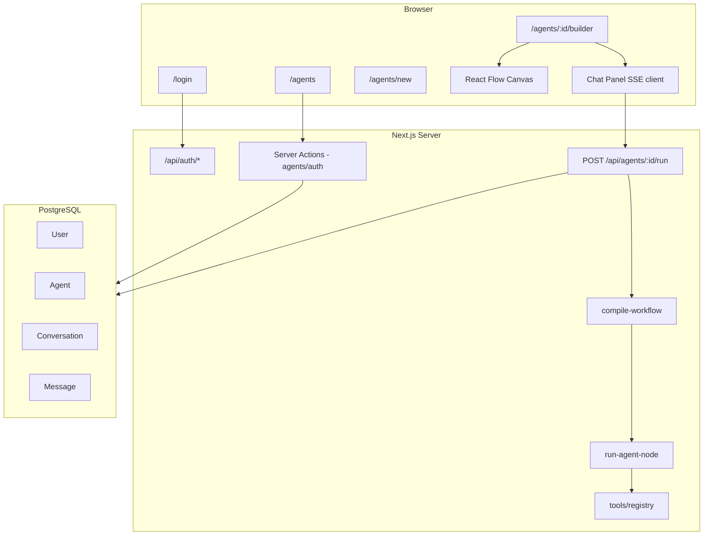
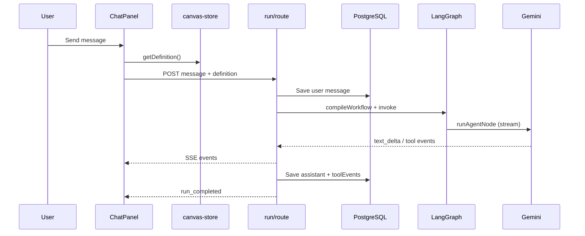

# Agent Builder — Project Overview

## What is this project?

This is a **Next.js 16** web app (`my-app/`) where authenticated users **design, save, and test AI agents** in a visual workflow builder. Agents are defined as a small graph (Start → Agent → End), configured with instructions, an LLM model, and tools. Users chat with agents in a built-in playground; runs are executed server-side with **LangChain** + **LangGraph** and stream back over **Server-Sent Events (SSE)**.

Think of it as a lightweight **no-code/low-code agent studio**: canvas on the left, settings/tools in the middle, test chat on the side.

---

## Tech stack

| Layer | Technology |
|--------|------------|
| Framework | Next.js 16 (App Router), React 19 |
| UI | Tailwind, shadcn/ui, @xyflow/react (canvas) |
| State (builder) | Zustand (`canvas-store`) |
| Data fetching | TanStack React Query |
| Auth | better-auth (GitHub OAuth) + Prisma |
| Database | PostgreSQL (Prisma 7) |
| AI runtime | LangChain, LangGraph, Google Gemini (`@langchain/google-genai`) |
| Tools | Tavily (web search), Cheerio, custom HTTP tools, GitHub API tools |
| Validation | Zod (workflow schema) |

**Required env (conceptually):** `GOOGLE_API_KEY`, database URL, `BETTER_AUTH_*`, optional `GITHUB_*` for OAuth and GitHub tools.

---

## High-level architecture



---

## Folder structure

```
my-app/
├── app/                          # Routes
│   ├── (auth)/login/             # Sign in
│   ├── (dashboard)/agents/       # List, new, builder
│   └── api/
│       ├── auth/[...all]/        # better-auth handler
│       └── agents/[agentId]/run/ # Streaming agent execution
├── modules/
│   ├── auth/                     # Session, sign-in, user button
│   ├── agents/                   # CRUD, templates, React Query hooks
│   ├── builder/                  # Canvas, nodes, serialize, Zustand store
│   ├── workflows/                # BuilderDefinition schema (v2), v1 migration
│   ├── runtime/                  # LangGraph compile + LLM + validation
│   ├── playground/               # Chat UI + SSE client
│   └── tools/                    # Built-in + GitHub + custom HTTP tools
├── prisma/schema.prisma          # User, Agent, Conversation, Message, auth tables
└── lib/                          # auth, db, Prisma client
```

---

## Data model (Prisma)

- **User** — owns agents; linked to better-auth sessions/accounts.
- **Agent** — `name`, `description`, `icon`, `welcomeMessage`, `starterPrompts`, plus:
  - **`draftDefinition`** (JSON) — logical workflow (nodes, edges, memory, limits, tools).
  - **`canvas`** (JSON) — React Flow node positions and visual state.
- **Conversation** / **Message** — chat history per user + agent; assistant messages store `toolEvents` JSON.

---

## Workflow definition (schema v2)

Defined in `modules/workflows/lib/schema.ts`:

- **Node types:** `start`, `agent`, `end`
- **Agent node config:** instructions, `modelId`, tools list, optional GitHub repo binding
- **Graph:** edges (validated as a **single linear path** Start → … → End)
- **Global settings:** `memory.enabled`, limits (`maxGraphSteps`, `maxToolCalls`, `timeoutMs`)

Older agents used **schema v1** (flat `AgentDefinition`). `modules/workflows/lib/migrate-v1.ts` upgrades v1 → v2 when loading/saving.

---

## User journey (end-to-end flow)

### 1. Authentication

1. User visits dashboard routes → `requireAuth()` in `app/(dashboard)/layout.tsx`.
2. Sign-in via GitHub → better-auth at `/api/auth/[...all]`.
3. Session stored in DB; OAuth can link GitHub token for GitHub tools.

### 2. Create an agent

| Path | What happens |
|------|----------------|
| **Blank** | `createBlankAgent()` → default definition in DB |
| **Template** | Pick weather / web-research / travel / etc. → `migrateV1ToV2(template.definition)` |

Routes: `/agents`, `/agents/new`, then `/agents/[agentId]/builder`.

### 3. Builder (visual editor)

`AgentBuilder` loads the agent into **Zustand `canvas-store`**:

1. `loadCanvasFromDraft` / `serialize.ts` merges `draftDefinition` + saved `canvas` positions.
2. **React Flow** shows Start, Agent, End nodes (`agent-canvas.tsx`).
3. User edits:
   - Agent instructions & model (`node-settings-pannel.tsx`)
   - Tools via `tool-picker.tsx` (built-in + custom HTTP + GitHub)
   - Memory toggle & limits in the store
4. **Save** → server action `saveAgent()` validates with `builderDefinitionSchema` and writes to Prisma.

Unsaved canvas changes trigger a `beforeunload` warning.

### 4. Test chat (playground)

1. User opens the chat drawer in the builder.
2. On send, `ChatPanel` calls `getDefinition()` from the store — **even unsaved edits** are sent to the API.
3. `streamAgentRun` → `POST /api/agents/:agentId/run`.

### 5. Run API (server)

`app/api/agents/[agentId]/run/route.ts`:

1. Authenticate; load agent owned by user.
2. Use request `definition` or fall back to saved `draftDefinition`.
3. Create or continue **Conversation**; persist user message.
4. `runAgentStream()` → stream events to client.
5. On completion, save assistant message + `toolEvents`; emit `run_completed`.

### 6. Runtime execution

```
runAgentStream
  → compileWorkflow (LangGraph StateGraph)
      → validateGraph (one start, one end, linear path, ≥1 agent)
      → for each node: start (bump step), agent (LLM), end (pass output)
  → invoke with userMessage, optional history (if memory on), timeout
```

**Agent node** (`modules/runtime/lib/run-agent-node.ts`):

- Builds messages: system instructions + history + user message.
- **Gemini** model (OpenAI path is commented in code).
- Tool loop: stream text deltas → if tool calls, invoke tools (cap `maxToolCalls`) → feed `ToolMessage` back until no more tools.

**Tools** (`modules/tools/registry.ts`):

| ID | Purpose |
|----|---------|
| `calculator`, `weather`, `web_search`, `read_webpage` | Built-in |
| `github_read_file`, `github_search_code`, `github_get_pr`, `github_get_diff` | GitHub (token + repo config) |
| Custom HTTP | User-defined in builder |

Events streamed to UI: `text_delta`, `tool_started`, `tool_completed`, `run_completed`, `run_failed`.

---

## Key design decisions

1. **Two representations:** logical `BuilderDefinition` + visual `canvas` JSON — synced via `modules/builder/lib/serialize.ts`.
2. **Test before save:** run endpoint accepts inline `definition` from the client store.
3. **Graph is simple today:** validation enforces a single chain (no branching yet).
4. **Memory:** when enabled, prior messages in the conversation are passed into the LLM; when disabled, each turn is largely stateless aside from the current user message.

---

## API & server actions

| Entry | Role |
|-------|------|
| `modules/agents/actions` | `listAgents`, `fetchAgent`, `createBlankAgent`, `createFromTemplate`, `saveAgent`, `deleteAgent` |
| `POST /api/agents/:id/run` | Streamed agent run + persistence |
| `modules/auth/actions` | `requireAuth` for server actions |

---

## How to run locally

```bash
cd my-app
pnpm install
# Configure .env: DATABASE_URL, GOOGLE_API_KEY, BETTER_AUTH_*, GITHUB_* as needed
pnpm prisma migrate dev   # if migrations exist
pnpm dev
```

Open the app → login → **My Agents** → create → **builder** → save → **test chat**.

---

## Sequence diagram: one chat message



---

## Summary

Authenticated users create agents from templates or scratch, configure them on a **React Flow** canvas (instructions, tools, memory, limits), persist definitions in **PostgreSQL**, and **test in real time** via an SSE chat that runs a **LangGraph** workflow ending in a **Gemini** agent node with optional **tools** (weather, search, GitHub, custom HTTP). The core contract is **`BuilderDefinition` (v2)** — from Zustand, through save actions, to the run API and runtime compiler.

---

## Notes

- Root `app/page.tsx` is still a default placeholder; the main app lives under `/agents`.
- LLM execution uses Google Gemini; `modelId` in the builder may not fully match the hardcoded runtime model.
- `README.md` is still the generic create-next-app template; use this file for project context.